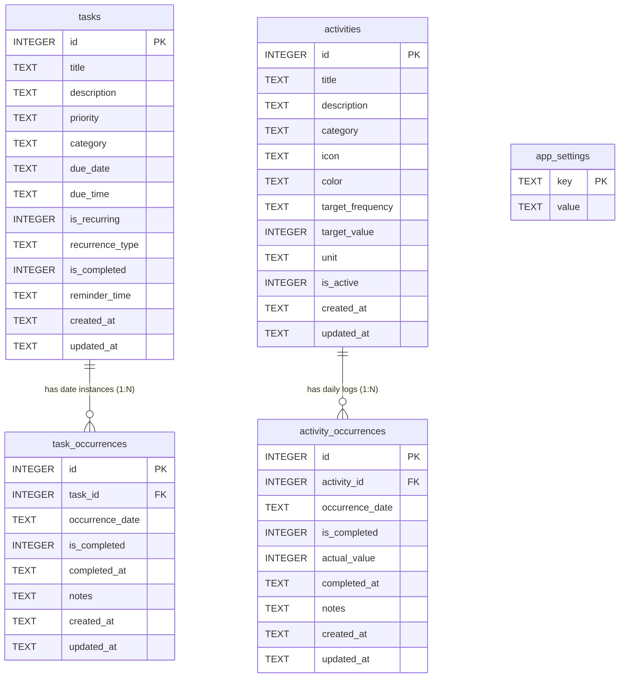
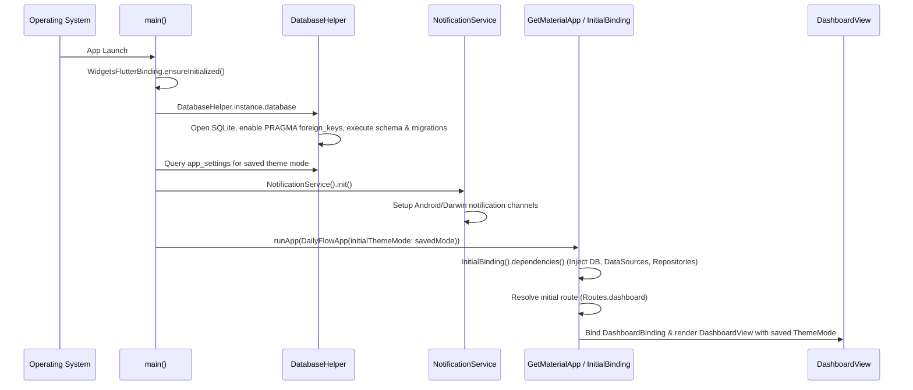

# DailyFlow — Daily Task & Activity Management App

> **Senior Flutter Architecture & Engineering Assignment**  
> An offline-first, high-performance daily task, activity, and habit management application engineered with Flutter, Dart, GetX, and SQLite.

---

## 1. Project Overview & Problem Statement

### Overview
**DailyFlow** is designed to bring order, clarity, and consistency to daily routines and professional workloads. Built with clean architecture and reactive state management, DailyFlow allows users to organize one-off tasks, track daily recurring activities and habits, inspect calendar timelines, and analyze productivity trends over time—all completely offline without requiring an account or network connection.

### Problem Statement
Most modern productivity and habit-tracking applications rely heavily on cloud synchronization, resulting in latency, privacy vulnerabilities, and app failure in low-connectivity or air-gapped environments. Furthermore, recurring task engines in simpler to-do apps often overwrite previous completion states or mistakenly pre-generate thousands of database records into the future, causing database bloat, slow queries, and inconsistent date-wise completion history.

**DailyFlow solves these challenges by:**
1. Operating **100% offline-first** using a lightweight, relational SQLite database with strict foreign key constraints and transactional integrity.
2. Employing an **on-demand date occurrence engine** that maintains isolated, historical completion records without duplicate occurrences or future state contamination.
3. Leveraging a strict **MVVM + Repository Pattern** architecture that decouples UI rendering from business rules and database mechanics.

---

## 2. Key Features Planned

- [x] **Solid Architectural Foundation**: MVVM with Repository Pattern, clean layers, and GetX dependency injection.
- [x] **Relational Offline SQLite Database**: 4 normalized tables with cascades, unique constraints, and date indexes.
- [x] **Occurrence Isolation Engine**: Date-wise occurrence isolation preventing past/future state overwrite.
- [x] **Material 3 Theming System**: Centralized Light and Dark themes with customizable status semantics.
- [x] **5-Tab Responsive Shell Navigation**: Home, Tasks, Calendar, Reports, and Settings.
- [x] **Premium Dashboard UI (Phase 2)**: Today's metrics, progress card, completion %, chronological timeline, and upcoming tasks.
- [x] **Complete Task Management (Phase 2)**: Add, edit, delete, mark completed, recurrence (one-time & daily), date ribbon, search, category & status filters, with inline form validation.
- [x] **Daily Recurring Activities & Habits (Phase 3)**: Daily recurring activities (Breakfast, Lunch, Exercise, Meetings, Medication), scheduled time, reminder toggle, active/inactive status, and date-wise occurrence history.
- [x] **Occurrence Status Engine (Phase 3)**: Completed, Skipped, Pending statuses, and automatic Missed/Overdue identification with strict date isolation.
- [x] **Interactive Calendar View (Phase 3)**: Monthly `table_calendar` view with dual-color event markers (tasks & activities), date summary cards, month navigation, and one-tap "Today" action.
- [x] **Local Reminders & Notifications (Phase 4)**: Offline native scheduled alerts (`flutter_local_notifications`), exact alarms, boot receivers, startup/resume reconciliation, and settings management.
- [ ] **Visual Productivity Analytics (Pending Phase 5)**: Daily and weekly completion charts (`fl_chart`).

---

## 3. Technology Stack & Dependencies

| Category | Technology | Purpose & Justification |
| :--- | :--- | :--- |
| **Framework** | Flutter 3.50+ / Dart 3.14+ | Cross-platform native compilation, null-safe language features. |
| **State Management & DI** | `get: ^4.7.3` | Reactive state management (`Obx`, `Rx`), dependency injection (`Bindings`, `Get.put`, `Get.lazyPut`), and named routing. |
| **Local Persistence** | `sqflite: ^2.4.6` | SQLite plugin for local, atomic, SQL-backed relational persistence. |
| **Path Utilities** | `path: ^1.9.1`, `path_provider: ^2.1.6` | Resolution of platform-standard directory paths for SQLite database files. |
| **Date & Time Formatting** | `intl: ^0.20.3` | ISO `yyyy-MM-dd` date formatting, parsing, and calendar localization. |
| **Charts & Analytics** | `fl_chart: ^1.3.1` | High-performance, customizable bar and line charts for weekly completion metrics. |
| **Calendar Engine** | `table_calendar: ^3.3.0` | Flexible calendar grid with date selection callbacks and marker builders. |
| **Local Notifications** | `flutter_local_notifications: ^23.0.2` | Native on-device scheduled reminders without third-party cloud services. |
| **Testing Driver** | `sqflite_common_ffi: ^2.4.7` *(dev)* | In-memory SQLite FFI driver allowing offline database unit testing on desktop/CI. |
| **Linter** | `flutter_lints: ^6.0.0` *(dev)* | Official Effective Dart coding standards and analyzer rules. |

---

## 4. Architecture Overview

DailyFlow enforces a unidirectional architectural flow ensuring that UI components remain dumb and reactive, business logic is isolated, and data sources can be swapped or tested independently.

### Architecture Flow

```
┌────────────────────────────────────────────────────────┐
│                   View (UI Layer)                      │
│   • Dumb widgets (Stateless / GetView)                 │
│   • Listens to Controller observables via Obx          │
│   • Delegates user events to Controller methods        │
└───────────────────────────▲────────────────────────────┘
                            │ (Events / Observable State)
┌───────────────────────────▼────────────────────────────┐
│              GetX Controller (ViewModel)               │
│   • Manages view state (isLoading, selectedDate, lists)│
│   • Contains zero SQL or UI layout logic               │
│   • Injected via GetX Bindings                         │
└───────────────────────────▲────────────────────────────┘
                            │ (Domain Models / Futures)
┌───────────────────────────▼────────────────────────────┐
│             Repository (Domain Layer)                  │
│   • Interface contract (TaskRepository)                │
│   • Orchestrates business rules & daily statistics     │
│   • Aggregates multiple datasources if needed          │
└───────────────────────────▲────────────────────────────┘
                            │ (CRUD Contracts)
┌───────────────────────────▼────────────────────────────┐
│            Local DataSource (Data Layer)               │
│   • Translates models to/from SQLite Maps              │
│   • Executes queries, raw SQL, and atomic transactions │
└───────────────────────────▲────────────────────────────┘
                            │ (SQL / Transactions)
┌───────────────────────────▼────────────────────────────┐
│          DatabaseHelper (SQLite Engine)                │
│   • Singleton SQLite connection manager                │
│   • Foreign key enforcement & schema migrations        │
└────────────────────────────────────────────────────────┘
```

---

## 5. Directory Structure

```
lib/
├── main.dart                               # Application bootstrap, service init & GetMaterialApp
├── app/
│   ├── bindings/
│   │   └── initial_binding.dart            # Global DI container (DatabaseHelper, Repositories)
│   ├── routes/
│   │   ├── app_pages.dart                  # GetPage definitions connecting routes to views & bindings
│   │   └── app_routes.dart                 # Centralized route name string constants
│   └── theme/
│       ├── app_colors.dart                 # Indigo primary, slate neutrals, status semantics
│       ├── app_theme.dart                  # Material 3 lightTheme and darkTheme configurations
│       └── app_typography.dart             # Material 3 typography definitions
├── core/
│   ├── constants/
│   │   ├── app_constants.dart              # Global constants, date formats, priority keys
│   │   └── db_constants.dart               # Table, column, and index string constants
│   ├── database/
│   │   └── database_helper.dart            # SQLite singleton, schema init, PRAGMA foreign keys, migrations
│   ├── services/
│   │   └── notification_service.dart       # Local notification scheduling service wrapper
│   ├── utils/
│   │   ├── app_logger.dart                 # Production debug and error logging utility
│   │   └── date_utils.dart                 # ISO date formatting, normalization, and week range helpers
│   └── widgets/
│       ├── custom_card.dart                # Rounded Material 3 card container
│       ├── empty_state_widget.dart         # Reusable zero-data presentation widget
│       └── status_badge.dart               # Completed (green), Pending (orange), Overdue (red) badges
├── data/
│   ├── datasources/
│   │   ├── activity_local_datasource.dart  # SQLite queries and transactions for activities & habits
│   │   └── task_local_datasource.dart      # SQLite queries and transactions for tasks & occurrences
│   ├── models/
│   │   ├── activity_model.dart             # Master activity entity (toMap, fromMap, copyWith)
│   │   ├── activity_occurrence_model.dart  # Date-specific activity log entity
│   │   ├── task_model.dart                 # Master task entity (toMap, fromMap, copyWith)
│   │   └── task_occurrence_model.dart      # Date-specific task occurrence entity
│   └── repositories/
│       ├── activity_repository.dart        # Activity repository contract and implementation
│       └── task_repository.dart            # Task repository contract and implementation
└── modules/
    ├── dashboard/
    │   ├── bindings/dashboard_binding.dart # Dashboard & bottom nav dependency setup
    │   ├── controllers/dashboard_controller.dart # Active navigation tab state
    │   ├── views/dashboard_view.dart       # Scaffold hosting Material 3 NavigationBar
    │   └── views/home_tab_view.dart        # Home dashboard overview tab view
    ├── tasks/
    │   ├── bindings/tasks_binding.dart
    │   ├── controllers/tasks_controller.dart
    │   └── views/tasks_view.dart
    ├── activities/
    │   ├── bindings/activities_binding.dart
    │   ├── controllers/activities_controller.dart
    │   └── views/activities_view.dart
    ├── calendar/
    │   ├── bindings/calendar_binding.dart
    │   ├── controllers/calendar_controller.dart
    │   └── views/calendar_view.dart
    ├── reports/
    │   ├── bindings/reports_binding.dart
    │   ├── controllers/reports_controller.dart
    │   └── views/reports_view.dart
    └── settings/
        ├── bindings/settings_binding.dart
        ├── controllers/settings_controller.dart
        └── views/settings_view.dart
```

---

## 6. Database Architecture

The local database (`daily_flow.db`) is managed through the `DatabaseHelper` singleton. Foreign key enforcement is explicitly activated on connection open via `PRAGMA foreign_keys = ON;`.

### Table Definitions

#### 1. `tasks`
Master record defining a task's template and rules.
```sql
CREATE TABLE tasks (
  id INTEGER PRIMARY KEY AUTOINCREMENT,
  title TEXT NOT NULL,
  description TEXT,
  priority TEXT NOT NULL DEFAULT 'medium',
  category TEXT DEFAULT 'Personal',
  due_date TEXT,
  due_time TEXT,
  is_recurring INTEGER NOT NULL DEFAULT 0,
  recurrence_type TEXT DEFAULT 'none',
  is_completed INTEGER NOT NULL DEFAULT 0,
  reminder_time TEXT,
  created_at TEXT NOT NULL,
  updated_at TEXT NOT NULL
);
```

#### 2. `task_occurrences`
Individual date-specific execution instance of a task.
```sql
CREATE TABLE task_occurrences (
  id INTEGER PRIMARY KEY AUTOINCREMENT,
  task_id INTEGER NOT NULL,
  occurrence_date TEXT NOT NULL,
  is_completed INTEGER NOT NULL DEFAULT 0,
  completed_at TEXT,
  notes TEXT,
  created_at TEXT NOT NULL,
  updated_at TEXT NOT NULL,
  FOREIGN KEY (task_id) REFERENCES tasks (id) ON DELETE CASCADE,
  UNIQUE(task_id, occurrence_date)
);
```

#### 3. `activities`
Master record defining a daily habit or routine template.
```sql
CREATE TABLE activities (
  id INTEGER PRIMARY KEY AUTOINCREMENT,
  title TEXT NOT NULL,
  description TEXT,
  category TEXT DEFAULT 'Personal',
  icon TEXT,
  color TEXT,
  target_frequency TEXT NOT NULL DEFAULT 'daily',
  target_value INTEGER NOT NULL DEFAULT 1,
  unit TEXT DEFAULT 'times',
  is_active INTEGER NOT NULL DEFAULT 1,
  created_at TEXT NOT NULL,
  updated_at TEXT NOT NULL
);
```

#### 4. `activity_occurrences`
Individual date-specific log of activity completion and progress.
```sql
CREATE TABLE activity_occurrences (
  id INTEGER PRIMARY KEY AUTOINCREMENT,
  activity_id INTEGER NOT NULL,
  occurrence_date TEXT NOT NULL,
  is_completed INTEGER NOT NULL DEFAULT 0,
  actual_value INTEGER NOT NULL DEFAULT 0,
  completed_at TEXT,
  notes TEXT,
  created_at TEXT NOT NULL,
  updated_at TEXT NOT NULL,
  FOREIGN KEY (activity_id) REFERENCES activities (id) ON DELETE CASCADE,
  UNIQUE(activity_id, occurrence_date)
);
```

#### 5. `app_settings` (v2 Migration)
Key-value preference storage ensuring offline-first persistence without introducing external preferences packages.
```sql
CREATE TABLE app_settings (
  key TEXT PRIMARY KEY,
  value TEXT NOT NULL
);
```

### High-Performance Date Indexes
```sql
CREATE INDEX IF NOT EXISTS idx_tasks_due_date ON tasks (due_date);
CREATE INDEX IF NOT EXISTS idx_task_occurrences_date ON task_occurrences (occurrence_date);
CREATE INDEX IF NOT EXISTS idx_task_occurrences_task_id ON task_occurrences (task_id);
CREATE INDEX IF NOT EXISTS idx_activity_occurrences_date ON activity_occurrences (occurrence_date);
CREATE INDEX IF NOT EXISTS idx_activity_occurrences_act_id ON activity_occurrences (activity_id);
```

### Entity Relationship Diagram



---

## 7. Application Initialization Flow

When DailyFlow starts, the following sequence executes deterministically:



---

## 8. Development & Installation Guide

### Prerequisites
- Flutter SDK `^3.50.0` or higher
- Dart SDK `^3.14.0` or higher

### Installation
1. Clone the repository and navigate to the project directory:
   ```bash
   cd daily_flow
   ```
2. Retrieve dependencies:
   ```bash
   flutter pub get
   ```
3. Run code formatting:
   ```bash
   dart format .
   ```
4. Run static analysis:
   ```bash
   flutter analyze
   ```
5. Execute the test suite:
   ```bash
   flutter test
   ```
6. Run the application on a simulator or device:
   ```bash
   flutter run
   ```

### Inspecting or Resetting the Local SQLite Database
During development, the SQLite database is located at:
- **macOS / iOS Simulator**:
  `~/Library/Containers/<AppBundleID>/Data/Documents/daily_flow.db`
- **Android**:
  `/data/data/com.example.daily_flow/databases/daily_flow.db`

#### To Reset the Database:
- **On Device/Simulator**: Clear app storage in device settings or uninstall the app and re-run `flutter run`.
- **In Automated Tests**: The test suite runs against in-memory SQLite (`inMemoryDatabasePath`) using `sqflite_common_ffi`, ensuring each test run starts with a clean database.

---

---

## 9. Phase 3 Architecture: Daily Activity Management & Calendar Screen

### 1. Daily Activity Management Module
The Daily Activities module enables users to configure recurring routines (such as Breakfast, Lunch, Exercise, Meetings, Medication, and Custom habits) with:
- **Title, Category, Scheduled Time (12h AM/PM), Reminder toggle, Frequency (Daily, Weekdays), and Active/Inactive status.**
- **Dual-Tab Interface**:
  - **Tab 1: Daily Schedule**: Interactive date-ribbon navigation, status filter chips (`All`, `Pending`, `Completed`, `Skipped`), summary stat pills, and `ActivityCard`s with immediate status toggle actions.
  - **Tab 2: All Routines**: Master template manager with active/inactive switches, editing, and confirmation-gated deletion.
- **Occurrence Status Operations**:
  - **Mark Completed**: Records `status = 'completed'`, sets `is_completed = 1`, and timestamp.
  - **Mark Skipped**: Records `status = 'skipped'`, sets `is_completed = 0`, and note `'Skipped'`.
  - **Keep Pending**: Resets `status = 'pending'`, clearing completion flags without touching historical data.

### 2. Date-wise Occurrence Logic & Isolation Engine
- **Master vs. Occurrence Separation**: Activity templates are defined in `activities`, while daily occurrences are recorded in `activity_occurrences`.
- **Strict Date Isolation**: Completing or skipping today's activity occurrence does not mutate past records or tomorrow's pending occurrence.
- **Duplicate Prevention**: Guaranteed at both the database level (`UNIQUE(activity_id, occurrence_date)`) and application level (`ConflictAlgorithm.ignore`).
- **Missed / Overdue Detection**: Occurrences on dates strictly before today that remain in a `pending` status are dynamically identified as `Missed` / `Overdue`.
- **Safe Deactivation**: Deactivating an activity sets `is_active = 0`, stopping future occurrence generation while preserving past history in full.

### 3. Professional Calendar Screen (`table_calendar`)
- **Monthly Grid**: Smooth month-to-month swipe and header chevrons.
- **Dual Event Dot Markers**:
  - Primary Indigo dot indicates scheduled **Tasks**.
  - Emerald Green dot indicates scheduled **Activities**.
  - Dual dots visually indicate dates with both tasks and activities.
- **Selected Date Details**:
  - `DateSummaryCard` showing formatted date and real-time count pills (`Done`, `Due`, `Overdue` for tasks; `Done`, `Skip`, `Due` for activities).
  - Segmented control to toggle between **Tasks List** and **Activities List**.
  - Interactive item cards allowing users to complete tasks or mark activities completed/skipped directly from the calendar.
- **One-Tap "Today" Action**: Quickly returns the calendar view and date selection to today.

### 4. Database Version 3 Migration
The SQLite database schema was upgraded to version 3 using incremental, versioned migrations:
```sql
-- Migration v2 -> v3
ALTER TABLE activities ADD COLUMN scheduled_time TEXT;
ALTER TABLE activities ADD COLUMN reminder_enabled INTEGER NOT NULL DEFAULT 0;
ALTER TABLE activity_occurrences ADD COLUMN status TEXT NOT NULL DEFAULT 'pending';
UPDATE activity_occurrences SET status = 'completed' WHERE is_completed = 1;
UPDATE activity_occurrences SET status = 'skipped' WHERE notes = 'Skipped';
```

---

## 10. Phase 4 Architecture: Local Notifications & Background Processing

DailyFlow Phase 4 establishes an offline-first notification and background reconciliation engine powered by `flutter_local_notifications` and the `timezone` package.

### 1. Notification Architecture & Scheduling Engine

```
┌────────────────────────────────────────────────────────┐
│               Task / Activity Repository               │
│   • On Create: scheduleNotification(entity)            │
│   • On Update: reschedule / cancel notification        │
│   • On Delete: cancelNotification(id)                  │
└───────────────────────────┬────────────────────────────┘
                            │
┌───────────────────────────▼────────────────────────────┐
│              NotificationService (GetxService)         │
│   • Lifecycle Observer (resumed state trigger)         │
│   • Deterministic ID generator                         │
│   • Exact alarm mode resolver (with fallback)          │
│   • Dual-direction reconciliation                      │
└───────────────────────────┬────────────────────────────┘
                            │
┌───────────────────────────▼────────────────────────────┐
│       FlutterLocalNotificationsPlugin + Timezone       │
│   • Android AlarmManager / ExactAlarmWhileIdle         │
│   • ScheduledNotificationBootReceiver (reboot survival)│
│   • High-priority Android notification channel         │
└────────────────────────────────────────────────────────┘
```

### 2. Deterministic Notification Identifier Scheme

To guarantee collision-free ID mapping and enable instant, O(1) correlation between database entities and OS-level pending alarms, DailyFlow uses partitioned deterministic 32-bit integer ranges:

| Entity Type | Base Offset | ID Formula | Example |
| :--- | :---: | :---: | :---: |
| **Tasks** (One-time & Recurring) | `1,000,000` | `1000000 + task.id` | Task #5 $\rightarrow$ Notification `1000005` |
| **Daily Activities / Routines** | `2,000,000` | `2000000 + activity.id` | Activity #3 $\rightarrow$ Notification `2000003` |

**Key Architectural Benefits:**
- **Zero Collision Risk**: Tasks and Activities operate in disjoint integer subspaces.
- **Bi-directional Mapping**: Given any notification ID, `id - 1000000` or `id - 2000000` identifies the exact underlying database row.
- **Natural Duplicate Prevention**: Scheduling with an existing deterministic ID automatically updates/overwrites the active alarm in the OS scheduler without creating duplicate alerts.

### 3. Scheduling Types & Recurrence Logic

1. **One-Time Tasks**:
   - Scheduled for `task.dueDate` at `task.reminderTime ?? task.dueTime`.
   - `matchDateTimeComponents: null` ensures the alert triggers exactly once.
   - If the calculated target datetime is in the past, scheduling is skipped, and any stale notification is cancelled.
2. **Daily Recurring Tasks**:
   - Scheduled at `task.reminderTime ?? task.dueTime` with `matchDateTimeComponents: DateTimeComponents.time`.
   - If today's target time has already passed, the initial trigger automatically rolls over to tomorrow at that time.
3. **Daily Recurring Activities**:
   - Scheduled at `activity.scheduledTime` with `matchDateTimeComponents: DateTimeComponents.time`.
   - Fires daily at the configured routine time (e.g., `08:00 AM`).
   - Automatically cancelled when the activity template is deactivated (`is_active = 0`) or reminder toggle is turned off.

### 4. Background Reconciliation Mechanism

Because an app may be terminated while tasks are completed on other screens, reminder times are edited, or schedules expire, DailyFlow runs an automated **Reconciliation Engine** on:
1. Application cold start (`main.dart`).
2. Application resume from background (`didChangeAppLifecycleState(AppLifecycleState.resumed)`).
3. Re-enabling notifications via the Settings screen.

**Reconciliation Pipeline:**
1. **Global Setting Check**: If master notifications are toggled OFF in app settings, all OS alarms are cancelled immediately and reconciliation halts.
2. **SQLite Query**: Loads all active tasks and active activities with reminders enabled.
3. **Expected ID Calculation**: Builds a set of expected notification IDs. Expired one-time tasks and completed tasks are omitted.
4. **OS Pending Inspection**: Queries `pendingNotificationRequests()` to obtain currently queued alarms in Android/iOS.
5. **Pruning Obsolete Alarms**: Any pending OS notification whose ID is absent from the expected set is cancelled.
6. **Missing / Updated Schedules**: Re-enqueues expected alarms to guarantee accurate payload, title, body, and trigger times.

### 5. Android Manifest, Permissions, & Device Reboot Handling

#### Android Permissions Declared:
```xml
<uses-permission android:name="android.permission.RECEIVE_BOOT_COMPLETED"/>
<uses-permission android:name="android.permission.VIBRATE"/>
<uses-permission android:name="android.permission.POST_NOTIFICATIONS"/>
<uses-permission android:name="android.permission.SCHEDULE_EXACT_ALARM"/>
<uses-permission android:name="android.permission.USE_EXACT_ALARM"/>
```

#### Native Receivers Configured:
```xml
<receiver android:exported="false" android:name="com.dexterous.flutterlocalnotifications.ScheduledNotificationReceiver" />
<receiver android:exported="false" android:name="com.dexterous.flutterlocalnotifications.ScheduledNotificationBootReceiver">
    <intent-filter>
        <action android:name="android.intent.action.BOOT_COMPLETED"/>
        <action android:name="android.intent.action.MY_PACKAGE_REPLACED"/>
        <action android:name="android.intent.action.QUICKBOOT_POWERON" />
        <action android:name="com.htc.intent.action.QUICKBOOT_POWERON"/>
    </intent-filter>
</receiver>
```

- **Reboot Persistence**: `ScheduledNotificationBootReceiver` listens for `BOOT_COMPLETED` and reinstates pending alarms registered by `flutter_local_notifications`.
- **Runtime Permission**: Requested via `NotificationService.to.requestPermissions()` on Android 13+ (API 33+).
- **Exact Alarms**: Checks `canScheduleExactNotifications()` on Android 12+ (API 31+). If granted, uses `AndroidScheduleMode.exactAllowWhileIdle`. If denied or restricted, gracefully falls back to `AndroidScheduleMode.inexactAllowWhileIdle`.

### 6. Settings Screen Controls & Safety Guarantee

- **Global Reminders Switch**: Enables or disables all scheduled alerts.
- **Permission Status Indicators**: Shows live permission status (`Active` vs `Denied`) and exact alarm capability.
- **Direct System Settings Shortcut**: `Open System Notification Settings` opens the native app notification settings page without leaving the app.
- **Data Safety**: Disabling notifications cancels pending OS alarms but **never deletes or modifies SQLite tasks, routines, or completion history**.

---

## 11. Current Implementation Status

| Milestone / Component | Status | Details |
| :--- | :---: | :--- |
| **Project Setup & Pubspec** | **Completed** | Clean dependencies configured (`get`, `sqflite`, `intl`, `fl_chart`, `table_calendar`, `flutter_local_notifications`, `timezone`). |
| **Folder Structure & Architecture** | **Completed** | Feature-based MVVM + Repository Pattern. |
| **SQLite Schema & Indexes** | **Completed** | Schema v3 with tasks, activities, occurrences, and settings tables. |
| **Data Models & DataSources** | **Completed** | Null-safe entities with `toMap()`, `fromMap()`, and transactional datasources. |
| **Repository Contracts & Impls** | **Completed** | `TaskRepository`, `ActivityRepository`, and `SettingsRepository` with notification triggers. |
| **Material 3 Theming** | **Completed** | Light and Dark palettes, typography, rounded cards, and status semantics. |
| **5-Tab Navigation Shell** | **Completed** | `DashboardView` with Material 3 `NavigationBar`. |
| **Premium Dashboard UI (Phase 2)** | **Completed** | Today's progress card, completion %, metrics, chronological timeline, and upcoming tasks. |
| **Task Management UI & CRUD (Phase 2)** | **Completed** | Task creation, editing, deletion, inline form validation, category/status filters, and search. |
| **Daily Activities & Habit Tracking (Phase 3)** | **Completed** | Master activity templates, scheduled time, reminder toggle, daily schedule view, and occurrence status engine. |
| **Calendar Timeline Screen (Phase 3)** | **Completed** | `TableCalendar` monthly view, dual-color task/activity dots, date summary metrics, and date item lists. |
| **Local Reminders & Notifications (Phase 4)** | **Completed** | One-time & daily task reminders, daily activity reminders, exact alarm fallback, boot receivers, startup/resume reconciliation, and settings UI. |
| **Visual Productivity Analytics (Phase 5)** | *Pending Phase 5* | `FLChart` weekly bar charts, trend analysis, and completion statistics. |

---

## 12. Known Limitations & Operating System Restrictions

1. **Android Force-Stop State**: If the user manually "Force Stops" the application from Android App Info settings, Android removes all scheduled alarms and disables broadcast receivers until the user manually relaunches the application. This is a core Android security constraint.
2. **Aggressive Battery Optimizers / OEM Task Killers**: Certain Android vendors (Xiaomi/MIUI, Huawei, Samsung) employ aggressive background app managers that can delay or drop inexact alarms. Users can whitelist DailyFlow under "Battery Optimization / Unrestricted" for best precision.
3. **Exact Alarm Permission on Android 13+**: Starting with Android 13, applications require user consent or system allowance for `SCHEDULE_EXACT_ALARM`. DailyFlow detects when this permission is restricted and gracefully falls back to inexact scheduling (`inexactAllowWhileIdle`) so alarms still fire near the scheduled time.
4. **Local Device Clock Dependency**: Because DailyFlow operates 100% offline without remote NTP servers, scheduled notification trigger times rely on the device's local system clock.
5. **No Cloud Push Dependency**: DailyFlow intentionally relies exclusively on on-device native schedulers, preserving user privacy and zero data leakage.
