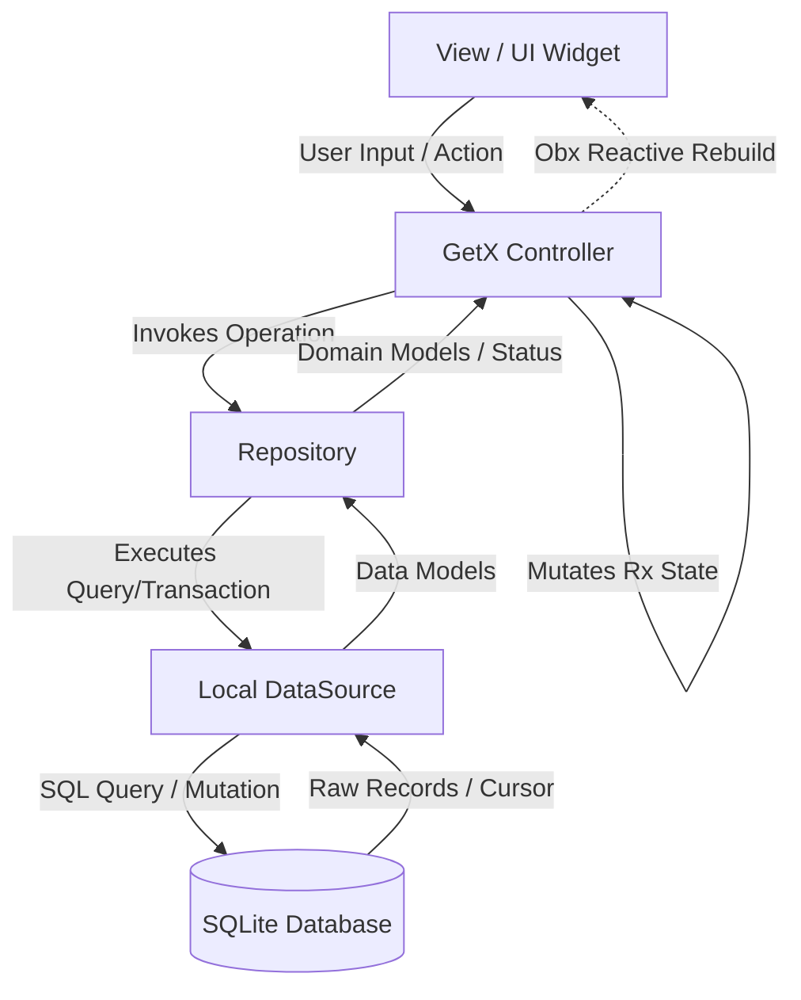
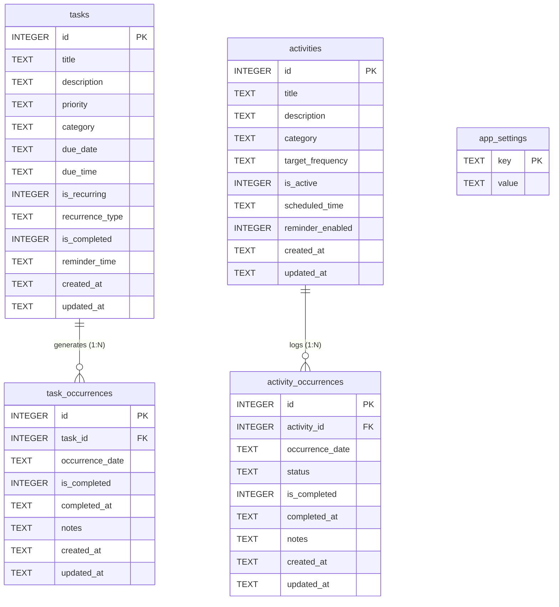

# DailyFlow — Daily Task & Activity Management App

> **Senior Flutter Architecture & Engineering Assignment**  
> An offline-first, high-performance daily task, recurring activity, and habit management application engineered with Flutter, Dart, GetX, and SQLite.

---

## Table of Contents
1. [Project Overview & Problem Statement](#1-project-overview--problem-statement)
2. [Key Features](#2-key-features)
3. [Architecture Overview](#3-architecture-overview)
   - [MVVM + Repository Pattern](#mvvm--repository-pattern)
   - [Unidirectional Data Flow Diagram](#unidirectional-data-flow-diagram)
   - [State Management & Dependency Injection](#state-management--dependency-injection)
   - [On-Demand Occurrence Engine](#on-demand-occurrence-engine)
4. [Database Choice & Justification](#4-database-choice--justification)
   - [Why SQLite? (Comparative Analysis)](#why-sqlite-comparative-analysis)
   - [Relational Schema & Tables](#relational-schema--tables)
   - [High-Performance Date Indexes](#high-performance-date-indexes)
   - [Entity Relationship Diagram](#entity-relationship-diagram)
5. [Setup & Installation Instructions](#5-setup--installation-instructions)
   - [Prerequisites](#prerequisites)
   - [Step-by-Step Installation](#step-by-step-installation)
   - [Running the Application](#running-the-application)
   - [Executing Tests](#executing-tests)
   - [Building Android APKs](#building-android-apks)
6. [Notifications & Background Scheduling](#6-notifications--background-scheduling)
   - [Deterministic ID Partitioning Scheme](#deterministic-id-partitioning-scheme)
   - [Scheduling Engine & Recurrence Logic](#scheduling-engine--recurrence-logic)
   - [Startup & Resume Reconciliation Pipeline](#startup--resume-reconciliation-pipeline)
   - [Boot Receiver & Alarm Survival](#boot-receiver--alarm-survival)
7. [Statistics, Reports & Analytics (Phase 5)](#7-statistics-reports--analytics-phase-5)
   - [Reporting Architecture](#reporting-architecture)
   - [Calculation & Aggregation Rules](#calculation--aggregation-rules)
   - [Read-Only Historical Integrity](#read-only-historical-integrity)
8. [Known Operating System Limitations & Platform Constraints](#8-known-operating-system-limitations--platform-constraints)
9. [Technology Stack & Dependencies](#9-technology-stack--dependencies)
10. [Directory Structure](#10-directory-structure)

---

## 1. Project Overview & Problem Statement

### Overview
**DailyFlow** is a professional, offline-first task and habit management mobile application designed to bring structure, clarity, and consistency to daily routines and professional workloads. Built with clean architecture, reactive state management, and an on-device relational SQLite database, DailyFlow enables users to organize one-time tasks, manage daily recurring routines (e.g., Breakfast, Medication, Exercise, Meetings), track completion timelines on an interactive calendar, and review productivity statistics—all completely offline with zero reliance on cloud services.

### Problem Statement
Most modern to-do and habit-tracking applications rely heavily on cloud APIs, creating network latency, requiring user accounts, risking privacy leakage, and failing in low-connectivity or air-gapped environments. Furthermore, recurring task engines in simpler applications frequently suffer from two critical architectural flaws:
1. **Destructive Overwrites**: Updating today's recurrence status inadvertently mutates past records or alters future occurrences.
2. **Pre-generation Database Bloat**: Inefficiently pre-inserting thousands of future recurrence rows causes slow queries, excessive disk usage, and duplicate rows.

### How DailyFlow Solves These Challenges:
- **100% Offline-First Relational Engine**: Operates locally using SQLite with enforced foreign key cascades, unique constraints, and atomic transactions.
- **On-Demand Occurrence Engine**: Maintains an isolated, date-specific execution log for recurring tasks and daily routines. Past history remains immutable, future occurrences remain untouched, and duplicate records are strictly prevented.
- **Strict Layer Decoupling**: Implements an enterprise-grade **MVVM + Repository Pattern** using GetX for dependency injection and fine-grained reactive updates (`Obx`), ensuring zero SQL or business logic leaks into UI widgets.

---

## 2. Key Features

| Category | Features Included |
| :--- | :--- |
| **Dashboard** | • Today's summary card with dynamic completion percentage and progress ring<br>• Metric counters for Completed, Pending, and Overdue tasks<br>• Chronological today's activity timeline<br>• Upcoming tasks list and quick-action completion toggles |
| **Task Management** | • Full CRUD (Create, Read, Update, Delete) for tasks with inline validation<br>• Support for one-time tasks and recurring tasks (Daily, Weekdays, Weekly)<br>• Category tagging (`Work`, `Personal`, `Health`, `Food`, `Others`) and priority levels (`Low`, `Medium`, `High`)<br>• Date selection, due time, and local reminder toggle<br>• Search bar and filters by Category and Completion Status |
| **Daily Activities & Routines** | • Recurring routines (e.g., Breakfast, Lunch, Exercise, Meetings, Medication)<br>• Dual-tab interface: Daily Schedule view and All Routines master manager<br>• Occurrence status engine: **Completed**, **Skipped**, and **Pending**<br>• Date-wise occurrence isolation ensuring future occurrences are never contaminated |
| **Interactive Calendar** | • Monthly `TableCalendar` view with smooth swipe and header chevrons<br>• Dynamic dual-color event marker dots (Indigo for Tasks, Emerald for Activities)<br>• High-contrast visibility on selected and dark-theme days<br>• Selected date summary card and segmented Tasks/Activities lists |
| **Statistics & Reports** | • **Daily Report**: Performance donut charts, task completion %, activity counts<br>• **Weekly Report**: 7-day progression bar chart (`fl_chart`), week totals, day-by-day comparison<br>• **Category Summary**: Activity breakdown by category with completion rates<br>• **Date-wise History**: Strictly read-only historical timeline with filter chips |
| **Notifications & Background** | • Native offline scheduling via `flutter_local_notifications`<br>• Exact alarm support (`SCHEDULE_EXACT_ALARM`) with graceful inexact fallback<br>• Device reboot recovery (`ScheduledNotificationBootReceiver`)<br>• Cold start and background resume reconciliation pipeline |
| **UI/UX & Theming** | • Modern Material 3 design with custom typography and smooth animations<br>• Dynamic Light and Dark theme support persisted locally<br>• Safe Area handling for modern edge-to-edge Android and iOS gesture bars |

---

## 3. Architecture Overview

DailyFlow follows an **MVVM (Model-View-ViewModel) Architecture** combined with the **Repository Pattern** and **Clean Layer Separation**.

```
┌────────────────────────────────────────────────────────┐
│                   View (UI Layer)                      │
│   • Stateless widgets and GetView implementations       │
│   • Binds to Controller observables using Obx          │
│   • Emits user events; contains zero business logic    │
└───────────────────────────▲────────────────────────────┘
                            │ (User Events / Obx Reactive Stream)
┌───────────────────────────▼────────────────────────────┐
│              GetX Controller (ViewModel)               │
│   • Manages observable state (RxBool, RxList, RxString)│
│   • Coordinates UI actions with Repositories           │
│   • Injected via GetX Bindings per feature route       │
└───────────────────────────▲────────────────────────────┘
                            │ (Domain Entities & Results)
┌───────────────────────────▼────────────────────────────┐
│             Repository (Domain Layer)                  │
│   • Abstract contracts (TaskRepository, ActivityRepo)  │
│   • Implements domain rules and business validations   │
│   • Triggers notification scheduling on state changes  │
└───────────────────────────▲────────────────────────────┘
                            │ (Data Transfer Models)
┌───────────────────────────▼────────────────────────────┐
│            Local DataSource (Data Layer)               │
│   • Converts models to/from SQLite Map records         │
│   • Executes queries, raw SQL, and atomic transactions │
│   • Implements duplicate guards and recurrence rules   │
└───────────────────────────▲────────────────────────────┘
                            │ (Atomic SQL & Pragma)
┌───────────────────────────▼────────────────────────────┐
│          DatabaseHelper (SQLite Engine)                │
│   • Singleton SQLite connection manager                │
│   • PRAGMA foreign_keys = ON enforcement               │
│   • Versioned schema creation and migrations           │
└────────────────────────────────────────────────────────┘
```

### Unidirectional Data Flow Diagram



### State Management & Dependency Injection
- **GetX State Management**: Fine-grained reactive primitives (`RxBool`, `RxInt`, `RxList`, `RxMap`) combined with `Obx` rebuild only the specific widgets that depend on modified state.
- **Bindings & Dependency Injection**: Every feature module has a dedicated binding (`DashboardBinding`, `TasksBinding`, `CalendarBinding`, `ReportsBinding`, `SettingsBinding`). Services and repositories are registered lazily via `Get.lazyPut()` or globally on app start in `InitialBinding`, ensuring deterministic lifecycles and easy test mocking.

### On-Demand Occurrence Engine
To eliminate duplicate rows and avoid pre-generating thousands of blank future dates, DailyFlow implements an **On-Demand Occurrence Engine**:
1. **Master Records (`tasks`, `activities`)**: Define the template (title, category, recurrence rule, reminder time).
2. **Occurrence Records (`task_occurrences`, `activity_occurrences`)**: Represent the execution state of an entity on a specific date (`occurrence_date`).
3. **Lazy Materialization**: When a user navigates to a date or opens the dashboard, `getOccurrencesForDate(isoDate)` inspects active recurring rules and inserts an occurrence using `INSERT OR IGNORE` protected by `UNIQUE(entity_id, occurrence_date)`.
4. **Historical Isolation**: Marking an occurrence completed or skipped updates only that date's row. Past history and future recurrences remain completely decoupled.

---

## 4. Database Choice & Justification

### Why SQLite? (Comparative Analysis)

During architectural planning, **SQLite** (via `sqflite`) was selected over NoSQL alternatives (Hive, Isar) and key-value preferences (SharedPreferences):

| Criteria | SQLite (`sqflite`) | Hive / Isar (NoSQL) | SharedPreferences |
| :--- | :--- | :--- | :--- |
| **Relational Integrity** | **Excellent**: Strict Foreign Keys with `ON DELETE CASCADE` automatically clean up occurrences when master tasks are deleted. | **Poor**: Requires manual cleanup code; orphaned records can easily occur on crash. | **None**: Flat key-value pairs only. |
| **Aggregations & Analytics** | **Excellent**: Live SQL aggregations (`COUNT`, `SUM`, `GROUP BY`, `BETWEEN ? AND ?`) execute at the C engine level in microseconds without memory overhead. | **Moderate**: Requires loading large record sets into Dart memory to filter and reduce. | **Unusable**: Cannot perform multi-attribute analytical queries. |
| **Duplicate Prevention** | **Native**: Composite `UNIQUE(task_id, occurrence_date)` constraints and `ConflictAlgorithm.ignore` prevent duplicate records at the database level. | **Manual**: Requires manual indexing and in-memory duplicate check loops. | **None**. |
| **Transaction Safety** | **ACID Compliant**: Multi-step operations execute inside `runInTransaction`, guaranteeing all-or-nothing execution. | **Limited**: Box-level atomic writes, but lack full relational multi-table transactions. | **None**. |
| **Testability** | **Seamless**: `sqflite_common_ffi` enables in-memory SQLite execution (`inMemoryDatabasePath`) for fast headless unit testing. | Requires custom temporary directory mocks on desktop/CI environments. | Mock-dependent. |

### Relational Schema & Tables

The database file `daily_flow.db` is managed by `DatabaseHelper`. Foreign keys are enforced on every connection via `PRAGMA foreign_keys = ON;`.

#### 1. `tasks` (Master Task Table)
```sql
CREATE TABLE tasks (
  id INTEGER PRIMARY KEY AUTOINCREMENT,
  title TEXT NOT NULL,
  description TEXT,
  priority TEXT NOT NULL DEFAULT 'medium',
  category TEXT DEFAULT 'Personal',
  due_date TEXT,
  due_time TEXT,
  is_recurring INTEGER NOT NULL DEFAULT 0,
  recurrence_type TEXT DEFAULT 'none',
  is_completed INTEGER NOT NULL DEFAULT 0,
  reminder_time TEXT,
  created_at TEXT NOT NULL,
  updated_at TEXT NOT NULL
);
```

#### 2. `task_occurrences` (Date-specific Task Execution Table)
```sql
CREATE TABLE task_occurrences (
  id INTEGER PRIMARY KEY AUTOINCREMENT,
  task_id INTEGER NOT NULL,
  occurrence_date TEXT NOT NULL,
  is_completed INTEGER NOT NULL DEFAULT 0,
  completed_at TEXT,
  notes TEXT,
  created_at TEXT NOT NULL,
  updated_at TEXT NOT NULL,
  FOREIGN KEY (task_id) REFERENCES tasks (id) ON DELETE CASCADE,
  UNIQUE(task_id, occurrence_date)
);
```

#### 3. `activities` (Master Recurring Routine Table)
```sql
CREATE TABLE activities (
  id INTEGER PRIMARY KEY AUTOINCREMENT,
  title TEXT NOT NULL,
  description TEXT,
  category TEXT DEFAULT 'Personal',
  icon TEXT,
  color TEXT,
  target_frequency TEXT NOT NULL DEFAULT 'daily',
  target_value INTEGER NOT NULL DEFAULT 1,
  unit TEXT DEFAULT 'times',
  is_active INTEGER NOT NULL DEFAULT 1,
  scheduled_time TEXT,
  reminder_enabled INTEGER NOT NULL DEFAULT 0,
  created_at TEXT NOT NULL,
  updated_at TEXT NOT NULL
);
```

#### 4. `activity_occurrences` (Date-specific Activity Log Table)
```sql
CREATE TABLE activity_occurrences (
  id INTEGER PRIMARY KEY AUTOINCREMENT,
  activity_id INTEGER NOT NULL,
  occurrence_date TEXT NOT NULL,
  status TEXT NOT NULL DEFAULT 'pending',
  is_completed INTEGER NOT NULL DEFAULT 0,
  actual_value INTEGER NOT NULL DEFAULT 0,
  completed_at TEXT,
  notes TEXT,
  created_at TEXT NOT NULL,
  updated_at TEXT NOT NULL,
  FOREIGN KEY (activity_id) REFERENCES activities (id) ON DELETE CASCADE,
  UNIQUE(activity_id, occurrence_date)
);
```

#### 5. `app_settings` (Application Preferences Table)
```sql
CREATE TABLE app_settings (
  key TEXT PRIMARY KEY,
  value TEXT NOT NULL
);
```

### High-Performance Date Indexes
```sql
CREATE INDEX IF NOT EXISTS idx_tasks_due_date ON tasks (due_date);
CREATE INDEX IF NOT EXISTS idx_task_occurrences_date ON task_occurrences (occurrence_date);
CREATE INDEX IF NOT EXISTS idx_task_occurrences_task_id ON task_occurrences (task_id);
CREATE INDEX IF NOT EXISTS idx_activity_occurrences_date ON activity_occurrences (occurrence_date);
CREATE INDEX IF NOT EXISTS idx_activity_occurrences_act_id ON activity_occurrences (activity_id);
```

### Entity Relationship Diagram



---

## 5. Setup & Installation Instructions

### Prerequisites
Before setting up DailyFlow, ensure your development environment satisfies the following requirements:

| Tool | Minimum Version | Description |
| :--- | :--- | :--- |
| **Flutter SDK** | `3.50.0` (tested on this version) | Cross-platform framework SDK |
| **Dart SDK** | Bundled with Flutter 3.50 (`^3.11.0`+) | Core programming language runtime |
| **Java Development Kit** | OpenJDK 11 or 17 | Required by Gradle Android build system |
| **Android Studio / SDK** | Android Studio Koala / Ladybug (SDK API 33+) | Android build tools and emulator |
| **Xcode** *(macOS only)* | Xcode 15.0+ | Required for compiling and running on iOS |
| **CocoaPods** *(macOS only)* | `1.12.0+` (`sudo gem install cocoapods`) | Dependency manager for iOS native pods |

### Step-by-Step Installation

1. **Clone the repository**:
   ```bash
   git clone https://github.com/your-org/daily_flow.git
   cd daily_flow
   ```

2. **Retrieve project dependencies**:
   ```bash
   flutter pub get
   ```

3. **Verify Flutter environment health**:
   ```bash
   flutter doctor
   ```
   *Ensure Flutter, Android toolchain, and Xcode (if on macOS) report no blocking issues.*

4. **Run code formatting & static analysis**:
   ```bash
   dart format .
   flutter analyze
   ```
   *The repository maintains 0 analyzer warnings.*

### Running the Application

- **On Android (Device or Emulator)**:
  ```bash
  flutter run
  ```

- **On iOS (Simulator or Physical Device)**:
  ```bash
  cd ios
  pod install
  cd ..
  flutter run
  ```

### Executing Tests
DailyFlow includes comprehensive automated unit, widget, and integration test suites covering data persistence, task management, recurrence engines, reporting, and notification scheduling.

```bash
flutter test
```
*Tests leverage `sqflite_common_ffi` with in-memory SQLite, running completely offline without requiring an emulator or device.*

### Building Android APKs

- **Build Release APK**:
  ```bash
  flutter build apk --release
  ```
  The generated APK will be output to:
  `build/app/outputs/flutter-apk/app-release.apk`

- **Build Debug APK**:
  ```bash
  flutter build apk --debug
  ```
  The generated debug APK is located at:
  `build/app/outputs/flutter-apk/app-debug.apk`

---

## 6. Notifications & Background Scheduling

DailyFlow includes a complete, offline local notification engine built on `flutter_local_notifications` and `timezone`.

### Deterministic ID Partitioning Scheme
To guarantee collision-free notification IDs across distinct domain models and enable instant correlation between notifications and database entities:

| Entity Type | Base Offset | ID Formula | Example |
| :--- | :---: | :---: | :---: |
| **Tasks** (One-time & Recurring) | `1,000,000` | `1000000 + task.id` | Task #5 $\rightarrow$ Notification `1000005` |
| **Daily Activities / Routines** | `2,000,000` | `2000000 + activity.id` | Activity #3 $\rightarrow$ Notification `2000003` |

### Scheduling Engine & Recurrence Logic
- **One-Time Tasks**: Scheduled for `task.dueDate` at `task.reminderTime ?? task.dueTime`. `matchDateTimeComponents: null` ensures single-fire execution. Past due dates are automatically skipped.
- **Daily Recurring Tasks**: Scheduled with `matchDateTimeComponents: DateTimeComponents.time`. If today's time has passed, scheduling rolls over to tomorrow.
- **Daily Recurring Activities**: Scheduled at `activity.scheduledTime` with daily repetition. Deactivating an activity cancels its notification.

### Startup & Resume Reconciliation Pipeline
To ensure OS-level alarms remain in sync with database states (e.g., tasks completed while notifications were off):
1. **Cold Start**: Evaluated in `main.dart` upon app launch.
2. **App Resume**: Evaluated when the app resumes from the background (`AppLifecycleState.resumed`).
3. **Settings Toggle**: Evaluated when reminders are re-enabled in Settings.

### Boot Receiver & Alarm Survival
- **Manifest Receiver**: `ScheduledNotificationBootReceiver` is registered in `AndroidManifest.xml` with `BOOT_COMPLETED` and `MY_PACKAGE_REPLACED`.
- When the device reboots, pending native alarms are automatically restored by the OS receiver without requiring the user to open the app.

---

## 7. Statistics, Reports & Analytics (Phase 5)

### Reporting Architecture
Statistical calculations are centralized in `ReportingService` and consumed by `ReportsController`. The UI renders four analytics sections:
1. **Daily Report**: Donut charts and progress metrics for a selected day.
2. **Weekly Report**: 7-day progression bar chart (`fl_chart`), week totals, and day-by-day comparison cards with week navigation.
3. **Category Summary**: Distribution donut chart and category cards showing total, completed, skipped, and completion rates.
4. **Date History**: Read-only timeline with filter chips (`All`, `Tasks`, `Activities`) and status badges.

### Calculation & Aggregation Rules

#### Daily Statistics:
For a selected ISO date $D$ (`yyyy-MM-dd`):
- $\text{taskTotal} = \text{Count of task occurrences where } \text{occurrence\_date} = D$
- $\text{taskCompleted} = \text{Count where } \text{occurrence\_date} = D \text{ and } \text{is\_completed} = 1$
- $\text{taskPending} = \max(0, \text{taskTotal} - \text{taskCompleted})$
- $\text{taskOverdue}$: If $D < \text{today}$, all uncompleted tasks on date $D$; if $D = \text{today}$, all uncompleted tasks with $\text{occurrence\_date} < \text{today}$; if $D > \text{today}$, $0$.
- $\text{taskCompletionRate} = \frac{\text{taskCompleted}}{\text{taskTotal}} \times 100\%$ (or $0\%$ if total is 0).
- $\text{activityCompleted} = \text{Count where } \text{status} = \text{'completed'}$
- $\text{activitySkipped} = \text{Count where } \text{status} = \text{'skipped'}$
- $\text{activityPending} = \max(0, \text{activityTotal} - \text{activityCompleted} - \text{activitySkipped})$

#### Weekly Statistics:
Aggregates the 7 days (Monday through Sunday) of the selected week:
- $\text{weekTaskCompleted} = \sum_{i=1}^7 \text{taskCompleted}_i$
- $\text{weekTaskTotal} = \sum_{i=1}^7 \text{taskTotal}_i$
- $\text{weekCompletionRate} = \frac{\text{weekTaskCompleted}}{\text{weekTaskTotal}} \times 100\%$

#### Read-Only Historical Integrity:
All records rendered in the History tab are strictly **read-only**. Tapping historical items displays details without mutating completion statuses, ensuring reports never distort historical data.

---

## 8. Known Operating System Limitations & Platform Constraints

| Constraint / Limitation | Platform | Architectural Impact | Mitigation / Handling in DailyFlow |
| :--- | :---: | :--- | :--- |
| **Android Force-Stop State** | Android | When a user performs "Force Stop" from Android Settings, the OS terminates all background processes, cancels all scheduled alarms, and blocks broadcast receivers. | Documented platform security behavior. Alarms are restored as soon as the user opens DailyFlow via the startup reconciliation engine. |
| **OEM Aggressive Battery Optimizers** | Android | Aggressive background managers (Xiaomi MIUI/HyperOS, Huawei EMUI, Samsung OneUI) throttle background alarms and delay execution to save battery. | The Settings screen informs users and provides a direct shortcut to app settings to configure "Unrestricted / No Battery Optimization" mode. |
| **Exact Alarm Permissions (`SCHEDULE_EXACT_ALARM`)** | Android 12+ (API 31+) | Starting with Android 12/13, scheduling exact minute-level alarms requires system permission. | DailyFlow checks `canScheduleExactNotifications()`. If granted, it uses `AndroidScheduleMode.exactAllowWhileIdle`; if denied, it gracefully falls back to `AndroidScheduleMode.inexactAllowWhileIdle`. |
| **Runtime Notification Permission (`POST_NOTIFICATIONS`)** | Android 13+ (API 33+) | Notifications cannot post banners or alerts without explicit runtime user consent. | Requested on initial startup and managed with live status indicators (`Active` vs `Denied`) in the Settings view. |
| **Device Reboot Behavior** | Android | Device power cycles clear volatile alarm memory in `AlarmManager`. | Handled by `ScheduledNotificationBootReceiver` listening for `BOOT_COMPLETED` and `MY_PACKAGE_REPLACED` to reinstate future alarms. |
| **Local System Clock Tampering** | Android / iOS | Offline applications rely on device hardware clock rather than remote NTP time. | All stored timestamps use UTC ISO-8601 formatting. The occurrence engine derives status from relative date comparisons. Future occurrences roll over deterministically. |
| **iOS Background Throttling** | iOS | iOS does not permit arbitrary background daemons for local scheduling. | Relies on native `UNUserNotificationCenter` with exact calendar trigger components, managed entirely on-device by iOS. |
| **Headless CI / Testing Database Driver** | Desktop / CI | Standard `sqflite` mobile bindings require native Android/iOS runtimes and fail in desktop test runners. | Handled by initializing `sqflite_common_ffi` (`sqfliteFfiInit(); databaseFactory = databaseFactoryFfi;`) in all test files using in-memory databases. |

---

## 9. Technology Stack & Dependencies

```yaml
dependencies:
  flutter:
    sdk: flutter
  cupertino_icons: ^1.0.8            # iOS-style iconography
  get: ^4.7.3                        # Reactive state management, DI & routing
  sqflite: ^2.4.6                    # SQLite native persistence engine
  path: ^1.9.1                       # Path manipulation utilities
  path_provider: ^2.1.6              # Device filesystem directory resolution
  intl: ^0.20.3                      # Date formatting & internationalization
  fl_chart: ^1.3.1                   # Data visualization & reporting charts
  table_calendar: ^3.3.0             # Interactive calendar timeline component
  flutter_local_notifications: ^23.0.2 # On-device local notification scheduler
  timezone: ^0.11.0                  # Timezone-aware date calculations

dev_dependencies:
  flutter_test:
    sdk: flutter
  flutter_lints: ^6.0.0              # Strict Flutter linting rules
  sqflite_common_ffi: ^2.4.7         # In-memory SQLite driver for headless testing
  flutter_launcher_icons: ^0.13.1    # Automated app launcher icon generation
```

---

## 10. Directory Structure

```
lib/
├── main.dart                               # App entry point, services bootstrap & GetMaterialApp
├── app/
│   ├── bindings/initial_binding.dart       # Core DI container (DB, DataSources, Repositories, Services)
│   ├── routes/
│   │   ├── app_pages.dart                  # Route definitions connecting routes to Views & Bindings
│   │   └── app_routes.dart                 # Route string constants
│   └── theme/
│       ├── app_colors.dart                 # Semantic color palette (Indigo, Emerald, Amber, Rose, Slate)
│       ├── app_theme.dart                  # Material 3 Light and Dark theme configurations
│       └── app_typography.dart             # Typography styles
├── core/
│   ├── constants/
│   │   ├── app_constants.dart              # Global app constants, categories, priorities
│   │   └── db_constants.dart               # Table and column schema constants
│   ├── database/
│   │   └── database_helper.dart            # SQLite singleton, PRAGMA foreign keys, migrations
│   ├── services/
│   │   ├── notification_service.dart       # Local notification scheduling & reconciliation service
│   │   └── reporting_service.dart          # Aggregation engine for daily/weekly/category statistics
│   ├── utils/
│   │   ├── app_logger.dart                 # Unified logging utility
│   │   └── date_utils.dart                 # ISO date formatting, week helpers, and date calculations
│   └── widgets/
│       ├── custom_card.dart                # Styled Material 3 card
│       ├── empty_state_widget.dart         # Empty data state graphic and message widget
│       └── status_badge.dart               # Status pill badges (Completed, Pending, Overdue)
├── data/
│   ├── datasources/
│   │   ├── activity_local_datasource.dart  # SQLite operations for activities & daily logs
│   │   └── task_local_datasource.dart      # SQLite operations for tasks & date occurrences
│   ├── models/
│   │   ├── activity_model.dart             # Activity master entity
│   │   ├── activity_occurrence_model.dart  # Activity date occurrence entity
│   │   ├── task_model.dart                 # Task master entity
│   │   └── task_occurrence_model.dart      # Task date occurrence entity
│   └── repositories/
│       ├── activity_repository.dart        # Activity repository contract and implementation
│       ├── settings_repository.dart        # Key-value SQLite settings repository
│       └── task_repository.dart            # Task repository contract and implementation
└── modules/
    ├── dashboard/                          # Home dashboard with progress card and timelines
    ├── tasks/                              # Task management, list, filtering, and TaskFormSheet
    ├── activities/                         # Daily activities management and ActivityFormSheet
    ├── calendar/                           # Monthly calendar view with event dots and details
    ├── reports/                            # Statistics dashboard: Daily, Weekly, Category, History
    └── settings/                           # Notifications toggle, exact alarm status, theme picker
```

---